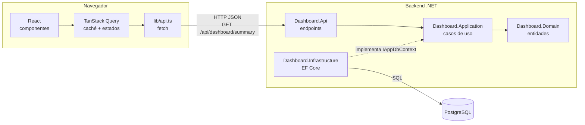
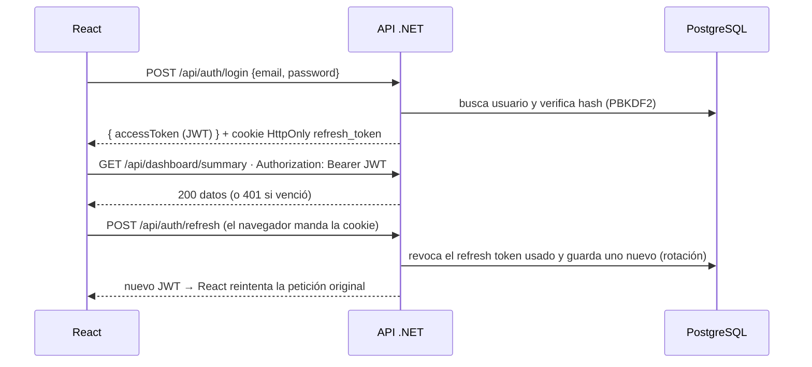

# Ventas MX · Dashboard empresarial

Dashboard de ventas e inventario para una PyME con varias sucursales.
Backend en **.NET 10** con Clean Architecture, base de datos **PostgreSQL** y frontend en **React + TypeScript**.

## Inicio rápido (demo local)

Requisitos: [Docker Desktop](https://www.docker.com/products/docker-desktop/), [.NET SDK 10](https://dotnet.microsoft.com/download) y [Node.js 22+](https://nodejs.org/).

1. Doble clic en **`iniciar-demo.cmd`**: levanta la base de datos, la API y el frontend, y abre el navegador.
2. Entra con una cuenta demo (botones en la pantalla de login, contraseña `Demo123!`).
3. Al terminar, doble clic en **`detener-demo.cmd`**.

## Funcionalidades

- **Resumen ejecutivo en lenguaje natural**: el dashboard redacta lo importante ("las 4 sucursales facturaron $8.5 M, +13.7 % frente al periodo anterior…").
- **Dashboard**: KPIs con **comparación contra el periodo anterior** y mini tendencias, ingresos por mes con el pico anotado, **mapa de calor de ritmo diario** (qué días se vende más), ranking de productos y participación por sucursal; filtros por periodo y sucursal; cada gráfica con vista de tabla.
- **Paleta de comandos (Ctrl/⌘ + K)**: navegar, cambiar tema o buscar un producto desde cualquier pantalla.
- **Productos**: búsqueda, paginación y estado de inventario; **alta, edición y baja** (solo Admin) con validación en navegador y servidor.
- **Exportar a Excel**: reporte del dashboard (4 hojas) y catálogo de productos, respetando los permisos del usuario.
- **Login con roles**: Admin, Gerente (limitado a su sucursal) y Vendedor (sin cifras financieras).
- Identidad visual propia (estilo editorial: tipografía serif + mono, rosa mexicano como único color de datos), modo claro/oscuro, responsive, animaciones que respetan "reducir movimiento", accesible (teclado, lectores de pantalla).

## Guion de demo (3 minutos)

1. **Login como Administrador** → dashboard completo. Cambia el periodo (3 / 6 / 12 meses) y la sucursal: todo se recalcula.
2. Lee el **resumen en texto** de arriba, pasa el mouse por el **mapa de calor** (fines de semana más intensos) y alterna **gráfica / tabla**. Activa el **modo oscuro**.
   Presiona **Ctrl + K**, escribe "silla" y Enter: te lleva al producto.
3. **Exportar Excel** → abre el archivo: 4 hojas con formato.
4. **Productos** → busca "silla", crea un producto con un error a propósito (precio menor al costo) para mostrar la validación; corrígelo, edítalo y elimínalo.
5. Intenta eliminar un producto con ventas → el sistema lo impide y explica por qué (integridad de datos).
6. **Cierra sesión y entra como Gerente** → solo ve Monterrey, sin poder cambiar de sucursal.
7. **Entra como Vendedor** → no ve el dashboard ni los botones de edición. Menciona que no es solo la pantalla: la API responde 403.
8. Cierra con la arquitectura: Clean Architecture, JWT con refresh token, validación en ambos lados, Docker.

## Stack

| Capa | Tecnología |
|---|---|
| Frontend | React 19, TypeScript, Vite, TanStack Query, React Router, React Hook Form + Zod, Tailwind CSS, Recharts |
| API | ASP.NET Core 10 (Minimal APIs), JWT Bearer, FluentValidation, rate limiting, OpenAPI + Scalar |
| Datos | EF Core 10, PostgreSQL 17 |
| Reportes | ClosedXML (Excel) |
| Infraestructura | Docker Compose, scripts de demo en PowerShell |

## Arquitectura



**Regla de dependencias (Clean Architecture):** las flechas apuntan hacia adentro.

- **Domain**: entidades y reglas de negocio (`Sale.AddItem`, `Product.IsLowStock`). No depende de nada.
- **Application**: casos de uso (`DashboardService`, `ProductService`). Define la interfaz `IAppDbContext` pero no sabe qué base de datos hay detrás.
- **Infrastructure**: implementa `IAppDbContext` con EF Core y PostgreSQL. Incluye migraciones y datos de demo.
- **Api**: expone los casos de uso como endpoints HTTP y conecta todo con inyección de dependencias en `Program.cs`.

Cambiar PostgreSQL por SQL Server solo implica tocar Infrastructure.

### Recorrido de una petición

1. El usuario elige "6 meses" en el filtro → `DashboardPage` arma `{ from, to, branchId }`.
2. `useDashboardSummary(filter)` (TanStack Query) revisa su caché; si no tiene esos datos, llama a `apiGet`.
3. `apiGet` hace `GET http://localhost:5080/api/dashboard/summary?from=...&to=...`.
4. El navegador valida **CORS**: la API permite el origen `http://localhost:5173`.
5. `DashboardEndpoints` recibe la petición; ASP.NET inyecta `DashboardService`.
6. `DashboardService` arma consultas LINQ sobre `IAppDbContext`; EF Core las traduce a SQL (`SUM`, `GROUP BY`) y las ejecuta en PostgreSQL.
7. La respuesta viaja como JSON → TanStack Query la guarda en caché → React vuelve a pintar las gráficas.

## Autenticación y roles

JWT de corta duración (15 min) + refresh token con rotación en cookie `HttpOnly`.



| Rol | Cuenta demo | Acceso |
|---|---|---|
| Administrador | `admin@ventasmx.demo` | Dashboard de todas las sucursales + productos |
| Gerente | `gerente@ventasmx.demo` | Dashboard **solo de su sucursal** (Monterrey) + productos |
| Vendedor | `vendedor@ventasmx.demo` | Solo productos (el dashboard responde 403) |

Contraseña de todas las cuentas demo: `Demo123!`

Decisiones de seguridad:
- **Contraseñas** con hash PBKDF2 + salt (`PasswordHasher` de ASP.NET Identity); nunca en texto plano.
- **Access token en memoria** (no en `localStorage`) para reducir el impacto de un XSS; se recupera al recargar con la cookie.
- **Refresh token** en cookie `HttpOnly` + `SameSite=Strict`, guardado en BD solo como hash SHA-256. Cada uno sirve una vez; si se reutiliza uno ya usado, se revocan todas las sesiones del usuario.
- **Autorización en el backend**: políticas por rol en los endpoints y filtrado de datos por sucursal en los servicios (el frontend solo oculta opciones, no protege).
- **Rate limiting** en el login (10 intentos/min por IP).
- La clave de firma JWT se valida al arrancar (mín. 32 caracteres). En producción se define con la variable de entorno `Jwt__Key`.

## Cómo correrlo manualmente

(Lo mismo que hace `iniciar-demo.cmd`, paso a paso.)

```bash
# 1. Base de datos
docker compose up -d

# 2. API  → http://localhost:5080  (docs: http://localhost:5080/scalar)
cd backend
dotnet run --project src/Dashboard.Api
#    Al arrancar en Development aplica las migraciones y siembra 12 meses de ventas de demo.

# 3. Frontend → http://localhost:5173
cd frontend
npm install
npm run dev
```

### Comandos útiles

```bash
# Nueva migración después de cambiar una entidad
cd backend
dotnet tool restore
dotnet ef migrations add NombreDelCambio --project src/Dashboard.Infrastructure --startup-project src/Dashboard.Api --output-dir Persistence/Migrations

# Reiniciar la base de datos desde cero (vuelve a sembrar los datos)
docker compose down -v && docker compose up -d
```

## Endpoints

| Método | Ruta | Acceso | Descripción |
|---|---|---|---|
| POST | `/api/auth/login` | Público (rate limit) | Inicia sesión |
| POST | `/api/auth/refresh` | Cookie | Renueva el access token |
| POST | `/api/auth/logout` | Cookie | Cierra sesión |
| GET | `/api/auth/me` | Autenticado | Usuario actual |
| GET | `/api/dashboard/summary?from&to&branchId` | Admin, Gerente | KPIs, ventas por mes, top productos, ventas por sucursal |
| GET | `/api/dashboard/export?from&to&branchId` | Admin, Gerente | Reporte del dashboard en Excel |
| GET | `/api/products?search&page&pageSize` | Autenticado | Productos paginados con búsqueda |
| GET | `/api/products/export?search` | Autenticado | Catálogo en Excel |
| GET | `/api/products/{id}` | Admin | Detalle para editar (incluye costo) |
| POST | `/api/products` | Admin | Crea producto (400 con errores por campo) |
| PUT | `/api/products/{id}` | Admin | Edita producto (el SKU no cambia) |
| DELETE | `/api/products/{id}` | Admin | Elimina (409 si tiene ventas) |
| GET | `/api/categories` | Autenticado | Catálogo de categorías |
| GET | `/api/branches` | Autenticado | Sucursales visibles para el usuario |
| GET | `/health` | Público | Health check |

## Estructura

```
backend/
  src/
    Dashboard.Domain/          entidades
    Dashboard.Application/     casos de uso + DTOs + IAppDbContext
    Dashboard.Infrastructure/  EF Core, configuraciones, migraciones, seeder
    Dashboard.Api/             Program.cs + endpoints
frontend/
  src/
    lib/                       cliente HTTP (token + refresh automático), formatos, tema
    features/auth/             login, contexto de sesión, guardias de ruta por rol
    types/                     tipos espejo de los DTOs
    components/                layout y componentes compartidos
    features/dashboard/        página, queries y gráficas del dashboard
    features/products/         tabla de productos
docker-compose.yml             PostgreSQL local
```

## Roadmap

- [x] Autenticación JWT + refresh token + roles (Admin, Gerente, Vendedor)
- [x] CRUD de productos con validación (FluentValidation + React Hook Form + Zod)
- [x] Exportar a Excel
- [x] Scripts para levantar/detener la demo local
- [ ] Contenerizar API y frontend (Dockerfile + Nginx) y desplegar en un VPS
- [ ] Notificaciones en tiempo real con SignalR
- [ ] Pruebas (xUnit + Testcontainers, Vitest)
- [ ] CI con GitHub Actions y despliegue con demo en vivo
