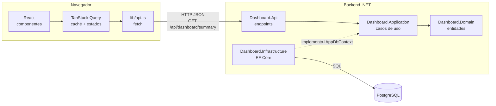

# Ventas MX · Dashboard empresarial

Dashboard de ventas e inventario para una PyME con varias sucursales.
Backend en **.NET 10** con Clean Architecture, base de datos **PostgreSQL** y frontend en **React + TypeScript**.

## Stack

| Capa | Tecnología |
|---|---|
| Frontend | React 19, TypeScript, Vite, TanStack Query, React Router, Tailwind CSS, Recharts |
| API | ASP.NET Core 10 (Minimal APIs), OpenAPI + Scalar |
| Datos | EF Core 10, PostgreSQL 17 |
| Infraestructura | Docker Compose |

## Arquitectura



**Regla de dependencias (Clean Architecture):** las flechas apuntan hacia adentro.

- **Domain**: entidades y reglas de negocio (`Sale.AddItem`, `Product.IsLowStock`). No depende de nada.
- **Application**: casos de uso (`DashboardService`, `ProductService`). Define la interfaz `IAppDbContext` pero no sabe qué base de datos hay detrás.
- **Infrastructure**: implementa `IAppDbContext` con EF Core y PostgreSQL. Incluye migraciones y datos de demo.
- **Api**: expone los casos de uso como endpoints HTTP y conecta todo con inyección de dependencias en `Program.cs`.

Cambiar PostgreSQL por SQL Server solo implica tocar Infrastructure.

### Recorrido de una petición

1. El usuario elige "6 meses" en el filtro → `DashboardPage` arma `{ from, to, branchId }`.
2. `useDashboardSummary(filter)` (TanStack Query) revisa su caché; si no tiene esos datos, llama a `apiGet`.
3. `apiGet` hace `GET http://localhost:5080/api/dashboard/summary?from=...&to=...`.
4. El navegador valida **CORS**: la API permite el origen `http://localhost:5173`.
5. `DashboardEndpoints` recibe la petición; ASP.NET inyecta `DashboardService`.
6. `DashboardService` arma consultas LINQ sobre `IAppDbContext`; EF Core las traduce a SQL (`SUM`, `GROUP BY`) y las ejecuta en PostgreSQL.
7. La respuesta viaja como JSON → TanStack Query la guarda en caché → React vuelve a pintar las gráficas.

## Cómo correrlo

Requisitos: .NET SDK 10, Node 22+, Docker Desktop.

```bash
# 1. Base de datos
docker compose up -d

# 2. API  → http://localhost:5080  (docs: http://localhost:5080/scalar)
cd backend
dotnet run --project src/Dashboard.Api
#    Al arrancar en Development aplica las migraciones y siembra 12 meses de ventas de demo.

# 3. Frontend → http://localhost:5173
cd frontend
npm install
npm run dev
```

### Comandos útiles

```bash
# Nueva migración después de cambiar una entidad
cd backend
dotnet tool restore
dotnet ef migrations add NombreDelCambio --project src/Dashboard.Infrastructure --startup-project src/Dashboard.Api --output-dir Persistence/Migrations

# Reiniciar la base de datos desde cero (vuelve a sembrar los datos)
docker compose down -v && docker compose up -d
```

## Endpoints

| Método | Ruta | Descripción |
|---|---|---|
| GET | `/api/dashboard/summary?from&to&branchId` | KPIs, ventas por mes, top productos, ventas por sucursal |
| GET | `/api/products?search&page&pageSize` | Productos paginados con búsqueda |
| GET | `/api/branches` | Catálogo de sucursales |
| GET | `/health` | Health check |

## Estructura

```
backend/
  src/
    Dashboard.Domain/          entidades
    Dashboard.Application/     casos de uso + DTOs + IAppDbContext
    Dashboard.Infrastructure/  EF Core, configuraciones, migraciones, seeder
    Dashboard.Api/             Program.cs + endpoints
frontend/
  src/
    lib/                       cliente HTTP, formatos, tema
    types/                     tipos espejo de los DTOs
    components/                layout y componentes compartidos
    features/dashboard/        página, queries y gráficas del dashboard
    features/products/         tabla de productos
docker-compose.yml             PostgreSQL local
```

## Roadmap

- [ ] Autenticación JWT + roles (Admin, Gerente, Vendedor)
- [ ] CRUD de productos con validación (FluentValidation + React Hook Form + Zod)
- [ ] Exportar a Excel / PDF
- [ ] Notificaciones en tiempo real con SignalR
- [ ] Pruebas (xUnit + Testcontainers, Vitest)
- [ ] CI con GitHub Actions y despliegue con demo en vivo
